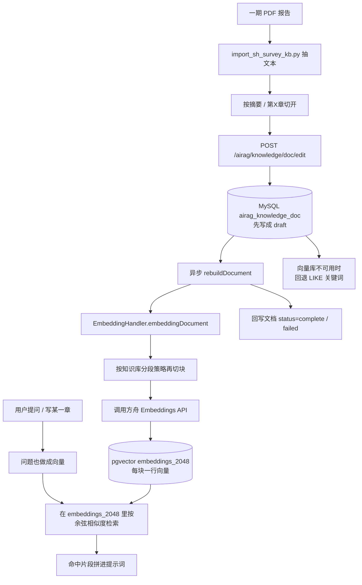

# 山洪调查成果知识库：向量化流程与数据落库说明

> 适用于本仓库「AI 知识库 → 山洪调查成果」以及山洪报告助手的知识检索。  
> 对照代码：`ai_flows/import_sh_survey_kb.py`、`EmbeddingHandler`、`AiragKnowledgeDocServiceImpl`、`ShReportKnowledgeService`。

---

## 1. 先看结论

向量化不是把 PDF 整份塞进一个库，而是 **两套存储各司其职**：

| 存什么 | 存在哪 | 作用 |
|---|---|---|
| 报告原文（按流域+章节切开的文本） | **MySQL** `jeecg-boot.airag_knowledge_doc` | 页面「共 N 条」看到的就是这些文档；失败时也可关键词检索 |
| 文本切块后的向量（embedding） | **Docker PostgreSQL + pgvector**，库 `vector_db`，表 `embeddings_2048` | 语义检索：问「大崖沟流域概况」时按相似度找片段 |
| 知识库、向量模型、API Key | **MySQL** `airag_knowledge` / `airag_model` | 指定用哪套模型、哪份知识库 |

**向量本身不进 MySQL。** MySQL 只记文档正文和状态（draft / building / complete / failed）；pgvector 里才是可检索的向量行。

当前本机约定：

- 向量库：容器 `jeecg-boot-pgvector`，宿主机端口 **5433**（不占用 5432，5432 给山洪一张图）
- 向量模型：火山方舟 Agent Plan，`doubao-embedding-vision`，OpenAI 兼容地址 `https://ark.cn-beijing.volces.com/api/plan/v3`
- 维度：**2048**，因此表名是 `embeddings` + `_2048` → `embeddings_2048`（1536 维会走无后缀的 `embeddings`）

---

## 2. 总体流程



页面上「共 24 条」统计的是 **MySQL 文档条数**，不是 PDF 份数，也不是向量行数。  
例如 4 份报告 ×（摘要 + 五章）= 24 条文档；每条再切成若干块后，pgvector 里可能是上百行（此前 24 条文档对应约 117 条向量）。

---

## 3. 入库：从 PDF 到 MySQL 文档

### 3.1 脚本做什么

脚本：`ai_flows/import_sh_survey_kb.py`

1. 扫描目录 `F:\省平台数据上报\一期上传平台报告-PDF版本` 下的 PDF（可用 `--only-four` 只导最初 4 份）。
2. 用 `pypdf` 抽正文，去掉页眉页码。
3. 按「成果报告摘要」和「第X章 …」切开。标题形如：`大崖沟流域 · 第一章 流域概况`。
4. 登录 Jeecg，调用 `POST /jeecg-boot/airag/knowledge/doc/edit`。
5. 后端 **先把全文写入 MySQL**，再 **异步触发向量化**。

同名标题默认跳过，避免把已 `complete` 的 24 条再向量化一遍。全量重来可加 `--wipe`。

### 3.2 页面入口（同样走后端）

| 操作 | 接口 | 结果 |
|---|---|---|
| 保存/编辑文档 | `POST /airag/knowledge/doc/edit` | 写 MySQL → 异步向量化 |
| 重建一篇 | `PUT /airag/knowledge/doc/rebuild?docIds=` | 只重建指定文档 |
| 重建整个知识库 | `PUT /airag/knowledge/rebuild?knowIds=` | 该库全部文档重新向量化 |
| 命中测试 | `GET /airag/knowledge/embedding/hitTest/{knowId}` | 用当前向量模型检索 |

无论脚本还是「AI知识库」界面点重建，**向量化主逻辑都是** `AiragKnowledgeDocServiceImpl.rebuildDocument` → `EmbeddingHandler.embeddingDocument`。

### 3.3 文档状态（MySQL）

| status | 含义 |
|---|---|
| `draft` | 正文已在 MySQL，还没向量化（或刚保存） |
| `building` | 正在切块、调 Embeddings API、写入 pgvector |
| `complete` | 本篇向量已写入；可被语义检索 |
| `failed` | 失败原因写在该行 `metadata.failedReason`；`building` 超过 5 分钟允许再重建 |

列表里能打开正文，只说明 MySQL 有稿；**只有 `complete` 才保证 pgvector 里有对应向量。**

---

## 4. 向量化内部在做什么

入口：`EmbeddingHandler.embeddingDocument`。

1. **读知识库配置**  
   `airag_knowledge.embed_id` → `airag_model`（当前为火山方舟 `doubao-embedding-vision`）。

2. **准备正文**  
   文本类型直接用 `content`；文件/网页类型会先解析。标题会拼到正文前面一起向量化。

3. **删旧向量**  
   按 metadata `docId = 当前文档 id` 从 pgvector 删掉本篇旧块，避免重复重建叠数据。

4. **二次切块**  
   导入时已经按章切开；入库后还要按知识库分段策略再切（默认 `maxSegment=3000`、`overlap=15`，见 `airag_knowledge.metadata`）。  
   一块太长会超模型上下文；太碎会让一次请求的 `input` 条数过多。

5. **调用 Embeddings API**  
   LangChain4j 按 OpenAI 协议请求：

   `POST https://ark.cn-beijing.volces.com/api/plan/v3/embeddings`  
   body 类似 `{ "model": "doubao-embedding-vision", "input": ["块1", "块2", ...] }`

   方舟限制 **单次 input 最多 10 条**。代码里用 `withEmbedBatchLimit` 按 10 条一批发送。

6. **写入 pgvector**  
   每一块对应一行：`embedding_id`（UUID）+ `embedding vector(2048)` + `text` + `metadata`（JSON，含 docId、knowledgeId、docName 等）。

7. **回写 MySQL 状态**  
   成功 → `complete`；抛错 → `failed` 并记下 `failedReason`。

维度不是 1536 时，表名会加后缀：`embeddings` + `_` + 维度。豆包 vision 是 2048，所以落在 `embeddings_2048`。  
pgvector 的 IVFFlat 索引最多 2000 维，2048 维不能建该索引，当前 `useIndex(false)`，小规模知识库用顺序扫描即可。

---

## 5. 数据最终存在哪里（按库拆开）

### 5.1 MySQL `jeecg-boot`（业务库，端口一般 3306）

**知识库** `airag_knowledge`

| 字段 | 本环境取值 | 说明 |
|---|---|---|
| id | `2099990000000000101` | 山洪报告助手 `shreport.knowledge.id` 指向它 |
| name | 山洪调查成果 | 页面上的知识库名 |
| embed_id | `2099990000000000103` | 绑定「火山方舟 豆包向量」 |
| metadata | `enableSegment / maxSegment / overlap` | 分段策略 |

**文档** `airag_knowledge_doc`

| 字段 | 说明 |
|---|---|
| id | 文档主键，写入向量 metadata 的 `docId` |
| knowledge_id | 归属知识库 |
| title | 列表标题，如 `大崖沟流域 · 第一章 流域概况` |
| type | 一期导入为 `text` |
| content | **完整章节正文**（给人看、给关键词回退用） |
| status | draft / building / complete / failed |
| metadata | 分段覆盖、失败原因等 |

**向量模型** `airag_model`（`model_type=EMBED`）

存供应商、模型名、`base_url`、加密在 `credential` 里的 API Key。Key **不会**进 pgvector。

### 5.2 PostgreSQL `vector_db`（Docker，宿主机 5433）

容器：`jeecg-boot-pgvector`  
镜像：`registry.cn-hangzhou.aliyuncs.com/jeecgdocker/pgvector`  
扩展：`vector 0.5.1`  
账号：`postgres` / `postgres`

表 `embeddings_2048`（LangChain4j `PgVectorEmbeddingStore` 自动建）：

| 列 | 类型 | 含义 |
|---|---|---|
| embedding_id | uuid | 这一块向量的主键 |
| embedding | vector(2048) | 模型输出的浮点向量 |
| text | text | 这一块的原文，检索命中后拼进提示词 |
| metadata | json | `docId`、`knowledgeId`、`docName`、`username`、`createTime` 等 |

配置来源：`application-dev.yml` → `jeecg.ai-rag.embed-store`（绑定到 `jeecg.airag.embed-store`）：

```yaml
host: 127.0.0.1
port: 5433
database: vector_db
user: postgres
password: postgres
table: embeddings
```

### 5.3 不要和另一套 PostgreSQL 搞混

| 端口 | 库 | 用途 |
|---|---|---|
| **5433** | Docker `vector_db` | **只有知识库向量** |
| **5432** | 本机 PostgreSQL `shreport_map` | 山洪一张图空间数据，**不是**向量库 |

改向量库端口或密码后必须重启后端，否则仍连旧地址。

---

## 6. 检索时怎么用这些数据

### 6.1 语义检索（主路径）

`EmbeddingHandler.searchEmbedding`：

1. 用 **同一套** 向量模型把用户问题也变成 2048 维向量。
2. 在 `embeddings_2048` 里按余弦相似度搜，过滤 `metadata.knowledgeId = 山洪调查成果`。
3. 取 `top-number`（默认 4）条、分数 ≥ `similarity`（默认 0.45）。
4. 返回每条的 `content`（块原文）、`score`、`docName`。

测试接口：`GET /airag/knowledge/embedding/hitTest/{knowId}?queryText=大崖沟流域概况&topNumber=3&similarity=0.3`

### 6.2 关键词回退

pgvector 连不上、模型失败、或向量 0 命中时，`ShReportKnowledgeService` 会 `LIKE` 查 `airag_knowledge_doc.title/content`。不依赖向量，但语义能力弱。

### 6.3 山洪报告助手里的两处用法

| 场景 | 方法 | 作用 |
|---|---|---|
| 对话「大崖沟摘要写了什么」 | `QUERY_KB` → `searchForAnswer` | 用检索片段回答，不生成新报告；回答附 SSE `kb_sources` 事件，前端渲染「一期调查成果参考来源」卡片；带最近两轮用户消息，支持「那塔子沟呢」式追问 |
| 写某一章 | `writingExamplesResult` | 优先按「第X章」标题精确取其他流域的整篇章节范文（默认 2 篇、每篇截 1800 字），向量/关键词检索兜底；**只学体例**，数字仍以实测数据包为准；参考了哪些范文会随生成过程推给用户，质检器也会拦截提示词泄漏和章节关键词缺失 |

配置：`shreport.knowledge.id / top-number / similarity`，范文相关新增 `shreport.knowledge.example-docs / example-chars / writing-max-chars`；体例规范在 `shreport/prompts/style.md`，由 `ShReportPromptLoader` 拼到各章系统提示词尾部。

---

## 7. 和「AI 应用 / 山洪助手」的关系

```
PDF 文件
   ↓ 导入脚本
MySQL 文档  +  pgvector 向量
   ↓
┌──────────────────┬────────────────────────────┐
│ AI知识库页面      │ 山洪报告助手                 │
│ 看正文、重建、    │ 写报告时参考体例             │
│ 命中测试          │ 对话时可 QUERY_KB 问答       │
└──────────────────┴────────────────────────────┘
         ↓
   「山洪调查成果问答」AI 应用（airag_app）
   也可在通用聊天里绑这个知识库
```

知识库 ID 固定为 `2099990000000000101`，方便助手配置写死，不必每次改页面。

---

## 8. 运维与排障

| 现象 | 常见原因 | 处理 |
|---|---|---|
| 列表有文档但检索很差 | `status=failed` 或向量表为空 | 看 `metadata.failedReason`，知识库点「重建」 |
| `CREATE INDEX ... ivfflat` 失败 | 2048 维超过 IVFFlat 上限 2000 | 已关索引；不要强行给该表建 ivfflat |
| `input limit exceeded: max 10` | 一次送了超过 10 个切块 | 已按 10 条分批；或把 `maxSegment` 调大减少块数 |
| 连上本机 5432 / 密码不对 | 连成一张图库或 PG18（无 vector 扩展） | 确认 `embed-store.port=5433`、用户 `postgres` |
| 换了向量模型检索全空 | 维度变了会换表（如 `embeddings_1024`） | 必须对该知识库 **整库重建** |
| 测试连接成功但重建失败 | 测试只 embed 一句；重建是整章多块 | 看失败原因是否为批次上限、余额、维度 |

自检 SQL / 命令示例：

```sql
-- MySQL：文档状态
SELECT status, COUNT(*) FROM airag_knowledge_doc
 WHERE knowledge_id='2099990000000000101' GROUP BY status;
```

```sql
-- pgvector：向量行数
-- docker exec jeecg-boot-pgvector psql -U postgres -d vector_db
SELECT COUNT(*) FROM embeddings_2048;
```

重新导入：

```bash
python ai_flows/import_sh_survey_kb.py
# 只导最初 4 份：  python ai_flows/import_sh_survey_kb.py --only-four
```

---

## 9. 相关代码与配置

| 内容 | 位置 |
|---|---|
| PDF 导入与切章 | `ai_flows/import_sh_survey_kb.py` |
| 保存文档并触发重建 | `AiragKnowledgeDocServiceImpl.editDocument / rebuildDocument` |
| 切块、调模型、写 pgvector | `EmbeddingHandler.embeddingDocument / getEmbedStore / searchEmbedding` |
| 助手检索与关键词回退 | `ShReportKnowledgeService` |
| 向量库连接 | `application-dev.yml` → `jeecg.ai-rag.embed-store` |
| 助手绑定知识库 | `application-dev.yml` → `shreport.knowledge` |
| Docker 向量库 | 仓库根目录 `docker-compose.yml` → `jeecg-boot-pgvector` |
| 添加模型目录（豆包向量） | `jeecgboot-vue3/src/views/super/airag/aimodel/components/model.json` |
