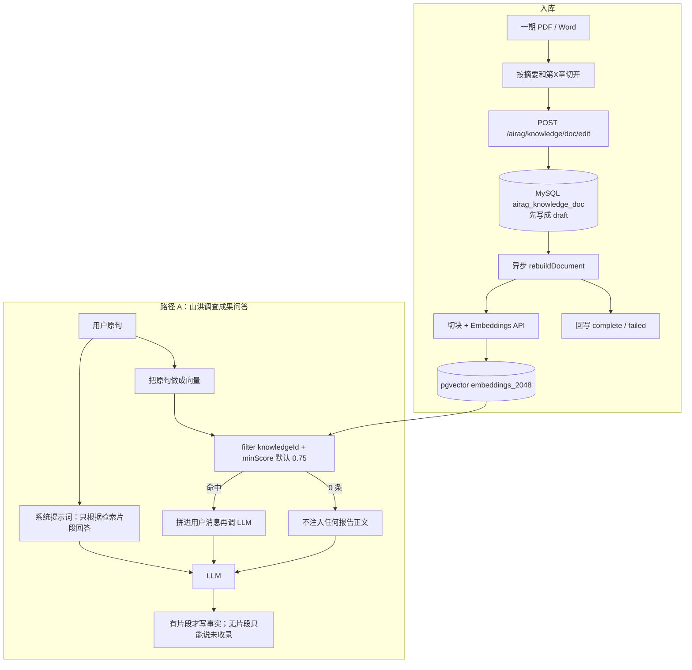

# 山洪调查成果知识库问答：完整流程与当前答不上问题的分析

> 性质：**只分析、不改代码。**  
> 日期：2026-09-19  
> 触发：AI 应用「山洪调查成果问答」对话无法回答实质问题（示例见 §1）。  
> 对照代码：`import_sh_survey_kb.py`、`AiragChatServiceImpl`、`AIChatHandler`、`EmbeddingHandler`、`ShReportKnowledgeService`。

---

## 1. 先看这条对话在说明什么

截取的界面是 **AI 应用聊天页**（`chat-container` / `rightArea`），应用名是 **「山洪调查成果问答」**，不是「山洪报告助手」。

可见轮次大致是：

| 角色 | 内容要点 | 实际发生了什么 |
|---|---|---|
| 用户 | 「你不联网访问数据吗」 | 元问题，和报告正文几乎无语义重叠 |
| 助手 | 「我不会联网……仅依托已入库报告检索……未收录会明确告知、绝不编造」 | **没有检索到片段**，模型在复述系统提示词 |
| 助手 | 「我配置模型的核心作用是更好承接查询……所有数字均来自检索片段」 | 仍是元问题/配置问题，检索仍空，继续复述定位 |
| 助手 | 「知识库未收录无明确流域指向的小流域介绍……请告知具体小流域名称」 | 用户问了介绍类问题但没点名流域；检索空 → 触发「知识库未收录」话术 |

这不是「模型坏了不说话」，而是 **检索为空 + 提示词禁止编造** 叠在一起，把对话锁死在「请告诉我流域名 / 知识库未收录」循环里。即使用户后面点了名，只要向量没命中，结果一样。

下面按完整链路说明：数据从哪来、问答怎么走、断在哪、和报告助手那条路差在哪。

---

## 2. 两套入口，不要混

同一份知识库被两条产品路径使用，**检索策略完全不同**。当前截图走的是路径 A。

```
一期 PDF/Word 报告
        │
        ▼
  MySQL 文档 + pgvector 向量
        │
        ├──────────────────────────────┐
        ▼                              ▼
路径 A：AI 应用「山洪调查成果问答」     路径 B：山洪报告助手
chatSimple + LangChain4j RAG          意图 QUERY_KB + Java 检索
默认相似度 0.75，无关键词回退           相似度 0.45，有 LIKE 回退
无来源卡片                             有 SSE kb_sources 卡片
```

| 项 | 路径 A（当前对话） | 路径 B（报告助手） |
|---|---|---|
| 页面 | AI 应用门户 / 应用聊天 | `/super/airag/shreport/ShReportAssistant` |
| 应用类型 | `airag_app.type = chatSimple` | 定制 Agent，不走 `airag_app` 聊天壳 |
| 入口 | `POST /airag/chat/send` → `AiragChatServiceImpl.sendWithAppChat` | `POST /sh/report/agent/chat/send` → `ShReportAgentService.handleQueryKb` |
| 检索 | `EmbeddingHandler.getQueryRouter`，只做向量 | `searchVector`，空则 `searchKeyword` |
| 默认 topK / 相似度 | 5 / **0.75**（应用 metadata 未配时） | 4 / **0.45**（`shreport.knowledge.*`） |
| 查询改写 | **无**，用当轮用户原句去 embed | 拼流域名 + 最近两轮用户话 + 本轮问题 |
| 空检索时 | 仍把原问题交给 LLM，靠提示词说「未收录」 | 直接回「目前收录的是白龙江水系大崖沟、塔子沟、噶沟里、南峪沟」 |
| 来源展示 | 无 | `kb_sources` 事件 |

路径 B 在「问大崖沟摘要写了什么」这类问题上更稳。路径 A 才是这次答不上的现场。

---

## 3. 端到端总流程



页面「共 N 条」统计的是 **MySQL 文档条数**，不是 PDF 份数，也不是向量行数。  
**只有 `status=complete` 才表示 pgvector 里有可检索向量。** 列表能打开正文，只说明 MySQL 有稿。

---

## 4. 入库：从报告到可检索向量

### 4.1 脚本与对象

脚本：`ai_flows/import_sh_survey_kb.py`

| 对象 | 固定 ID | 说明 |
|---|---|---|
| 知识库 | `2099990000000000101` | 名称「山洪调查成果」 |
| AI 应用 | `2099990000000000102` | 名称「山洪调查成果问答」，`type=chatSimple` |
| 向量模型（优先） | `2099990000000000103` | 火山方舟 `doubao-embedding-vision`，维度 2048 |
| 对话模型 | `1897883052995006466` | 脚本写入的默认 LLM；页面可覆盖 |

### 4.2 切分规则

1. 用 `pypdf` / Word 抽正文，去掉页眉页码。
2. 切出「成果报告摘要」+ 各「第 X 章 …」。
3. 标题形如：`大崖沟流域 · 第一章 流域概况`。
4. 正文前缀：`流域：…\n章节：…\n来源：文件名\n\n`。
5. 超约 22000 字或 60KB 再拆「续 N」，避免单次 Embeddings `input` 超过方舟 10 条上限。

默认可导目录下全部 PDF；`--only-four` 只导白龙江 4 份。PDF 失败可用 `--word-patch` 补 13 份 Word。

仓库里的预览快照 `ai_flows/output/kb_preview/import_result.json`：**4 流域 ×（摘要 + 五章）= 24 条，当时状态全部是 `draft`。**  
`draft` = 正文已在 MySQL，向量化尚未成功。路径 A **不会**回退去读 MySQL 正文。

### 4.3 向量化内部

`AiragKnowledgeDocServiceImpl.rebuildDocument` → 异步 `EmbeddingHandler.embeddingDocument`：

1. 标题拼到正文前一起切块。
2. 按知识库 metadata 分段（当前约定 `maxSegment=3000`、`overlap=15`，即 15% 重叠）。
3. 删掉该 `docId` 的旧向量，再写入 `embeddings_2048`。
4. 成功回写 `complete`，失败 `failed` 并记 `metadata.failedReason`。

`building` 超过 5 分钟才允许再重建。同名标题默认跳过，避免把已 complete 的再向量化一遍。

### 4.4 数据落在哪

| 库 | 端口 | 存什么 |
|---|---|---|
| MySQL `jeecg-boot` | 3306 | 知识库配置、文档全文、应用 prompt、模型 Key |
| Docker PG `vector_db` | **5433** | 向量行（`embeddings_2048`） |
| 本机 PG `shreport_map` | 5432 | 一张图空间数据，**不是**向量库 |

向量本身不进 MySQL。换向量模型导致维度变化会换表（如 `embeddings_1024`），必须整库重建。

---

## 5. 路径 A 问答：从点发送到气泡

这是当前对话真正走的链路。

### 5.1 前端

页面：`jeecgboot-vue3/src/views/super/airag/aiapp/chat/chat.vue`

- 发送 `content`、`appId`、可选 `modelId`（顶栏切换模型）、`enableSearch`、`enableThink`。
- **不会**单独传知识库 ID、topK、相似度；这些全看应用配置。
- 「联网搜索」是 Brave Search 工具开关，和知识库检索不是一回事。本应用提示词还禁止用外部数据，即使用户打开联网，模型也会按提示词拒绝。

### 5.2 后端组装

`AiragChatServiceImpl.doChat` → `sendWithAppChat` → `sendWithDefault`：

1. 把应用 `prompt` 做成 `SystemMessage`。
2. 从 `airag_app.metadata` 读 `topNumber` / `similarity`（**导入脚本没有写入这两项**）。
3. `knowIds` 取 `airag_app.knowledge_ids`（应为 `2099990000000000101`）。
4. `msg_num=8`：最多带 8 轮历史。
5. `AIChatHandler.chat` → `mergeParams`：若有 knowIds，则 `embeddingHandler.getQueryRouter(...)`。

### 5.3 检索器默认值（关键）

`EmbeddingHandler.getQueryRouter`：

- `topNumber` 为空 → **5**
- `similarity` 为空 → **0.75**
- `filter`：`metadata.knowledgeId = 当前知识库`

前端参数设置弹窗若打开过且未改，还会把应用 metadata 写成 **similarity=0.76**（`AiAppParamsSettingModal.vue`）。  
命中测试接口 `hitTest` 走的是另一套：`searchEmbedding`，缺省相似度取向量模型配置，文档里助手侧常用 **0.45**。

所以会出现：**知识库页面用 0.3～0.45 能测到，聊天却 0 命中。**

### 5.4 注入方式

LangChain4j `QueryRouter` + `RetrievalAugmentor`：

- 用 **本轮用户原句** 做 query embedding（不拼历史、不抽流域名）。
- 余弦相似度 ≥ minScore 的块注入用户消息。
- 测试代码里的注入模板是：`{{userMessage}}\n\n用以下信息回答问题:\n{{contents}}`。
- **0 条命中时不注入任何报告正文**，LLM 只看到系统提示词 + 聊天历史。

路径 A **没有** MySQL `LIKE` 回退。pgvector 空、分数全低于 0.75、或 embed 失败，效果都是「没给模型任何调查成果」。

### 5.5 应用提示词（导入脚本每次会覆盖）

```
你是「山洪调查成果」知识库助手。只根据检索到的一期调查成果报告回答。
覆盖甘肃省一期上传平台各小流域调查成果报告。
数字、对象名称、建议必须来自检索片段；没有的内容明确说「知识库未收录」。
禁止编造未入库流域数据。
```

配套效果：

- 检索有内容 → 可以按片段答。
- 检索为空 → 模型被要求说「知识库未收录」，不能用常识、不能列已入库流域清单（提示词里也没写清单）。
- 元问题（联网吗、模型干什么）→ 只能复述定位，像「在念说明书」。
- 未点名流域的介绍 → 「未收录无明确流域指向…请告知名称」。

预设问题其实写得很具体（「大崖沟流域报告摘要写了什么？」等），但用户若不点预设、按自然口语问，就掉进上面的空检索。

---

## 6. 路径 B（对照）：报告助手里的知识库问答

仅当意图是 `QUERY_KB`（提到一期 / 成果报告 / 摘要 / 原来怎么写 / 范文等）才走。

`ShReportKnowledgeService.searchForAnswer`：

1. 查询串 = 会话流域名 + 最近两轮用户话 + 本轮问题（所以「那塔子沟呢」能接上文）。
2. 向量检索，`top-number=4`，`similarity=0.45`。
3. 向量 0 命中 → `LIKE` 查 `airag_knowledge_doc.title/content`。
4. 仍空 → 直接告诉用户目前收录哪几条流域，**不把空上下文交给模型去猜**。
5. 有命中 → 系统提示「只根据给定检索片段回答」+ 用户消息里显式附上片段；并推 `kb_sources`。

写作场景另有 `writingExamplesResult`：按「第 X 章」标题精确取其他流域整篇范文，向量/关键词兜底；只学体例，数字仍以实测数据包为准。那是写报告，不是这条聊天。

---

## 7. 把当前对话逐步对回代码

以截图四条为准，还原路径 A 每一步。

### 7.1 「你不联网访问数据吗」

1. 原句送去 embed。报告块讲的是桥涵、防治对象、摘要，和「联网」余弦分会很低。
2. `minScore=0.75` 基本全过滤。
3. 无注入。模型只看见「只根据检索片段；未收录要说未收录；禁止编造」。
4. 于是回答：不联网、只查已入库报告。这是 **提示词回声**，不是知识库命中。

用户心里的「访问数据」往往是：查已入库报告 / 查调查库。系统把「联网」理解成外网，两边说的不是一件事。知识库检索走本机 5433，本来就不需要外网（Embeddings/LLM API 除外）。

### 7.2 「配置模型是干什么的」一类

同样 0 命中。模型只能把 prompt 里的职责再讲一遍。看起来像在答，但没有任何流域数字。

### 7.3 「小流域介绍」但没点名

检索器不会先列出知识库里有哪些流域。没有流域名，query 更泛，更难 ≥ 0.75。  
提示词又不许根据常识介绍「小流域是什么」。结果就是那句：「知识库未收录无明确流域指向的小流域介绍内容，请告知甘肃省具体小流域名称」。

### 7.4 即使用户接下来改口「大崖沟摘要写了什么」仍可能失败

下面任一成立，路径 A 仍会空检索：

1. 文档还是 `draft` / `failed` / 卡在 `building`（预览 JSON 曾全部 draft）。
2. 向量表空、连错 5432、或换模型后维度表不一致。
3. 相似度 0.75/0.76 对中文报告块过严（助手侧 0.45 才是按这个库调过的）。
4. PDF 封面页是「小 流 域 山 洪…」逐字空格；若切章失败、大段进向量，query「大崖沟流域概况」对不上。
5. 查询不改写：多轮里只说「那第一章呢」，不含「大崖沟」，可能打到别的流域或 0 命中。

路径 B 在第 1 点仍可能靠 LIKE 读出 MySQL 正文；路径 A 不能。

---

## 8. 问题清单（按对「答不上」的贡献）

### P0 机制：空检索 + 过严提示词（已能解释截图）

路径 A 在 0 命中时仍调用 LLM，却要求「没有检索片段就说未收录、不准编」。  
元问题、泛问题、未点名流域，会稳定复现截图那种循环。  
**这是产品策略和检索失败处理的问题，不是某一条 SQL 写错。**

### P1 相似度默认值两套标准

| 场景 | 相似度 |
|---|---|
| 路径 A `getQueryRouter` 缺省 | **0.75** |
| 应用参数弹窗缺省 | **0.76** |
| 路径 B / 文档约定 | **0.45** |
| 命中测试示例 | 0.3 |

导入脚本不写 `airag_app.metadata.topNumber/similarity`，聊天几乎一定走 0.75。对 2048 维中文块，相关内容常见落在 0.5～0.7，会被直接丢掉。

### P1 路径 A 无关键词回退

`ShReportKnowledgeService` 有 LIKE；`AiragChatServiceImpl` 没有。  
向量未建好时，助手还能从 MySQL 抠片段，应用聊天完全不能。

### P1 文档状态可能仍是 draft

`import_result.json` 中 24 条全是 `draft`。若后来没在「AI 知识库」点重建、或重建失败，路径 A 会 **永远 0 命中**。  
脚本在登录/接口失败时会走 `insert_docs_sql`，只写草稿并提示去页面重建——容易漏做。

### P2 查询不改写、不带历史

LangChain4j 用当轮原句检索。不抽「某某流域」，不把上一轮「大崖沟」拼进 query。多轮追问弱。路径 B 专门做了最近两轮用户消息。

### P2 提示词不含「库里有什么」

没有写：已入库流域名单、请先点名、元问题怎么答、空检索时列出可查清单。  
模型不知道大崖沟/塔子沟/噶沟里/南峪沟已经在库里，只能说「请你告诉我名称」。

### P2 空检索没有用户可见的失败信号

路径 A 不推送来源、不提示「向量 0 条 / 分数过低」。用户只看到一句「未收录」，无法区分：没入库、没向量化、阈值太高、还是问题太泛。

### P3 PDF 文本质量

- 封面/目录常见逐字空格，语义检索差。
- 正文摘要（如 `ch1_full.txt` 第 3 页起）一般正常。
- 表格被抽成 `单元格 | 单元格` 行，数字还在，结构弱。
- `CHAPTER_RE` 要求行首「第X章」且标题里尽量不要点号；目录行带省略号会被跳过（这是故意的），但正文标题若被抽成「第 一 章」会切不到章，整篇变成一条大文档。

### P3 导入会覆盖应用 prompt

`ensure_app` 每次跑都 `UPDATE` prompt / prologue / model_id。页面上改过的提示词或 RAG 参数，下次导入可能被刷掉。metadata 的相似度若从未保存，会一直保持 0.75。

### P3 「联网」能力容易误导

`enableSearch` 只在前端打开且配置了 Brave Key 时注入搜索工具。当前 `application-dev.yml` 里 Brave `api-key: ??`。即使用户打开，本应用提示词也不允许用外网结果。知识库问答不依赖外网网页，依赖的是 Embeddings API + 本地 pgvector。

### 不是主因的项

- LangGraph 报告编排、章节质检、Word 导出：不经过这条聊天。
- 路径 B 的 `looksLikeKbQuestion`：只影响报告助手是否走 QUERY_KB。
- 页面切换对话模型：只换生成模型，不换向量模型；向量模型在知识库 `embed_id`。

---

## 9. 对象、接口、配置速查

### 9.1 应用与提示词（库表）

`airag_app`（id `2099990000000000102`）：

- `type=chatSimple`，`knowledge_ids=2099990000000000101`
- `prompt` / `prologue` / `preset_question` 由导入脚本写入
- `msg_num=8`
- `metadata`：若含 `topNumber`/`similarity` 才会覆盖 5 / 0.75

### 9.2 接口

| 用途 | 方法 | 路径 |
|---|---|---|
| 应用对话（本问题现场） | POST | `/airag/chat/send`（及分享/调试变体） |
| 保存文档并异步向量化 | POST | `/airag/knowledge/doc/edit` |
| 重建一篇 / 整库 | PUT | `/airag/knowledge/doc/rebuild` 、 `/airag/knowledge/rebuild` |
| 命中测试 | GET | `/airag/knowledge/embedding/hitTest/{knowId}?queryText=&topNumber=&similarity=` |
| 报告助手对话 | POST | `/sh/report/agent/chat/send` |

### 9.3 配置

```yaml
# application-dev.yml
jeecg.ai-rag.embed-store:   # 5433 / vector_db / embeddings
shreport.knowledge:
  enabled: true
  id: '2099990000000000101'
  top-number: 4
  similarity: 0.45          # 只作用于路径 B
```

路径 A **不读** `shreport.knowledge.similarity`。

---

## 10. 建议怎么验证（仍不改代码）

按顺序做，才能判断是「没向量」还是「有向量但聊天阈值太高」还是「只有提示词在说话」。

**① MySQL 文档状态**

```sql
SELECT status, COUNT(*) FROM airag_knowledge_doc
 WHERE knowledge_id='2099990000000000101' GROUP BY status;

SELECT id, title, LEFT(content,80)
  FROM airag_knowledge_doc
 WHERE knowledge_id='2099990000000000101'
 ORDER BY title;
```

期望：多数 `complete`。若大量 `draft`/`failed`，先看 `metadata.failedReason`，在「AI 知识库」重建。

**② 应用是否绑库、RAG 参数**

```sql
SELECT id, name, type, knowledge_ids, model_id, metadata, LEFT(prompt,200)
  FROM airag_app
 WHERE id='2099990000000000102' OR name='山洪调查成果问答';
```

`knowledge_ids` 必须是知识库 ID。`metadata` 若无 similarity，聊天就是 0.75。

**③ pgvector 是否有行**

```sql
-- docker exec jeecg-boot-pgvector psql -U postgres -d vector_db
SELECT COUNT(*) FROM embeddings_2048;
SELECT metadata->>'knowledgeId' AS kid, COUNT(*)
  FROM embeddings_2048 GROUP BY 1;
```

**④ 命中测试（同一套向量，阈值自己定）**

对同一句分别试 `similarity=0.75` 和 `0.45`：

- `queryText=你不联网访问数据吗` → 两种阈值都应接近 0 条（元问题本就不该命中报告）。
- `queryText=大崖沟流域报告摘要写了什么` → 0.45 应有摘要块；若 0.75 变 0，就是聊天答不上事实题的直接原因。
- `queryText=小流域介绍` → 即使 0.45 也可能空或很杂，说明必须点名流域。

**⑤ 对照报告助手**

在山洪报告助手里问「大崖沟成果报告摘要写了什么」。  
若助手能答且出现来源卡片、应用聊天不能，则问题在路径 A 的阈值/无回退，而不在 PDF 没入库。

**⑥ 看重建日志**

后端日志关键字：`开始重建文档` / `重建文档成功` / `向量存储失败` / `input limit exceeded`。

---

## 11. 若后续改，建议方向（本文不实施）

只列优先级，便于和流程对照。

1. **空检索不要再让模型自由发挥「未收录」**：0 条时直接回已入库流域名单 + 请用预设问法；元问题单独答「不访问外网，检索的是已入库报告」。
2. **路径 A 的 similarity 与路径 B 对齐到 0.45**，并写入 `airag_app.metadata`，避免弹窗默认 0.76。
3. **chatSimple 增加关键词回退**（或 0 命中时查 `airag_knowledge_doc`），避免 draft 时完全失明。
4. **查询改写**：从用户句和最近历史抽出「某某流域」，拼进向量 query。
5. **提示词补充库存清单和预设问法**；导入脚本不要无条件覆盖人工改过的 prompt/metadata。
6. **聊天回传来源**（docName/score），否则无法区分「没检索」和「检索了但不采用」。
7. 入库后检查 `complete` 数量与向量行数；draft 未重建则不要打开应用给人用。

---

## 12. 结论（针对这次对话）

当前这条「一直回复不了问题」的对话，主因是：

1. 走了 **AI 应用路径 A**，不是报告助手路径 B。  
2. 用户问的是 **联网 / 模型职责 / 未点名的介绍**，向量检索按设计就不会命中报告块。  
3. 路径 A **默认 0.75 且无关键词回退**，空结果不会降级到 MySQL 正文。  
4. 系统提示词在空结果时 **强制「知识库未收录」、禁止编造**，所以只能循环要流域名、复述定位。  
5. 预览数据曾显示 **24 条全是 draft**；若现场仍未 `complete`，连「大崖沟摘要写了什么」这种预设问题在路径 A 也会失败。

入库链路（切章、MySQL、pgvector）和报告助手检索，与这条聊天是同一知识库、不同用法。要验证「库有没有问题」，用 §10 的状态 SQL + 命中测试（0.75 vs 0.45）即可定位是草稿、阈值还是问法。
