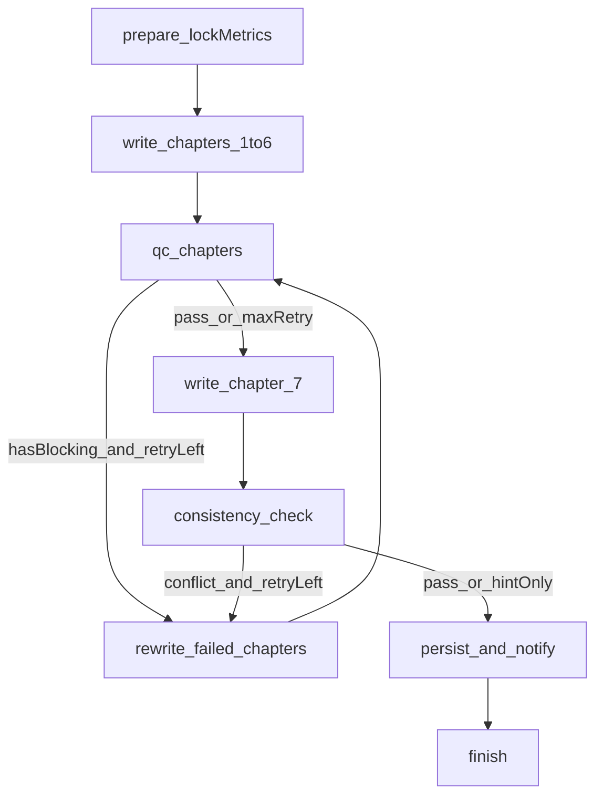

# 山洪报告 LangGraph 编排改造计划

> 状态：**P0–P2 已落地。** 开关 `shreport.graph.enabled` / `direct-llm` 可回滚。
> 日期：2026-09-15
> 范围：仅山洪报告生成编排；Jeecg 其它 AI 应用不动。

---

## 1. 为什么改

当前报告生成是 **LiteFlow 单向链 + Java 补丁**：

```
airag_flow 每章：开始 → LLM → 落库 → 结束
ShReportGenerateService：1–6 并行、第 7 章串行、质检失败只重试 1 次
```

做不了图内回边：质检不通过回到写作、跨章数字打架回到对应章、用户改一章只跑子图。

流程 catch 还会把任意 LLM 失败显示成「模型未配置或调用失败」，和真实原因对不上。

## 2. 改什么、不改什么

**做**

- 用 LangGraph4j（Java 17，`org.bsc.langgraph4j:langgraph4j-core` 1.8.x）接管报告的循环和条件跳转。
- 对外接口保持不变：助手对话 / SSE / 单章重生成 / 审核 / 导出 Word。

**不做**

- 不替换 Jeecg Airag 可视化设计器。
- 不改其它 AI 应用、聊天、知识库。
- 不上 Python LangGraph 服务。
- 本轮不做 Redis checkpointer、图内人审 interrupt、前端「当前节点」展示（列为 P3）。

## 3. 目标编排



单章重生成：同一张图，只设 `targetChapters = [该章]`，仍走 `write → qc → rewrite`。

## 4. 设计要点

### 4.1 新包

`org.jeecg.modules.airag.shreport.graph`

| 类 | 职责 |
|---|---|
| `ShReportGraphState` | 图状态 |
| `ShReportGraphRunner` | 编译图、对外 `run` |
| `ShReportGraphNodes` | prepare / write / qc / rewrite / consistency / persist |

### 4.2 State 字段

`batchNo`、`lybm`、`lymc`、`outline`、`modelId`、`requirement`、`targetChapters`、`chapters`、`qcIssues`、`retryCount`、`maxRetry`（默认 2）、`cancelled`。

### 4.3 节点（复用现有服务）

- `prepare`：`ShReportMetricService.lockDataMetrics`、标记「生成中」
- `write`：P0/P1 仍调现有 `runChapterFlow`；P2 改为 `AIChatHandler` + 抽出的提示词
- `qc`：`ShReportQualityChecker`
- `rewrite`：BLOCK 问题写入 requirement，只重跑失败章
- `consistency`：`ShReportConsistencyChecker`；矛盾章加入 `targetChapters` 回写
- `persist`：落库、质检表、第 1 章抽指标、`ProgressListener`

条件：`hasBlocking && retryCount < maxRetry` → rewrite；否则前进。取消读 State.`cancelled`。

### 4.4 接入点（签名不改）

- `ShReportGenerateService.generateAll` / `generateChapter` → `ShReportGraphRunner`
- `ShReportAgentService.startGenerate`、章节面板 `regenerate` 不用改 API

开关：`shreport.graph.enabled`（默认 true；false 走旧逻辑，便于回滚）。

依赖：只在 `jeecg-boot-module-airag/pom.xml` 加 `langgraph4j-core`。LLM 仍走现有 `AIChatHandler`，避免和 LangChain4j 1.17.2 抢版本。第一期不用 checkpointer。

## 5. 阶段

### P0 骨架（先可跑）

1. 加依赖、State、StateGraph。
2. 假 write 节点单测：BLOCK 回写、达上限前进、取消短路。
3. `generateChapter` 切到图：`write → qc → rewrite(最多 2 次) → persist`。
4. 开关可回退。

### P1 整份报告

1. `generateAll`：1–6 章并行写（节点内沿用现有 `chapterPool`）。
2. 批量质检 → 回写失败章 → 第 7 章 → 跨章校验（矛盾回写对应章；HINT 不阻断）。
3. SSE 的 `progress` / `text` / `refresh` 与现在一致。

### P2 报告写作脱离 LiteFlow

1. 7 章提示词从 `airag_flow.design` 抽到 `classpath:shreport/prompts/ch{n}.md`。
2. `write` 改为 `AIChatHandler.completions(modelId, …)`；`sjbao` / `tigang` / `buochong` 仍由现有 DataPacket / Outline 服务注入。
3. 报告生成不再依赖 `airag_flow` 变体；设计器旧流程保留不删。

### P3（确认后另开，本轮不做）

- Redis checkpointer、图内 interrupt 等人审大纲。
- 前端展示当前图节点 / 回写次数。

## 6. 主要改动文件（确认后才动）

**新增**

- `.../shreport/graph/ShReportGraphState.java`
- `.../shreport/graph/ShReportGraphRunner.java`
- `.../shreport/graph/ShReportGraphNodes.java`
- `.../src/test/java/.../shreport/ShReportGraphRunnerTest.java`
- P2：`src/main/resources/shreport/prompts/ch1.md` … `ch7.md`

**修改**

- `jeecg-boot-module-airag/pom.xml`
- `ShReportGenerateService.java`（编排入口切到 Runner）
- `application-dev.yml`（`shreport.graph.enabled`）

**不改签名**

- `ShReportAgentController` / `ShReportChapterController` / 前端 `ShReportAssistant.api.ts`

## 7. 验收

- 单测：回边、达上限、取消、跨章回写第 N 章。
- 现有 QualityChecker / Consistency / Intent 单测仍绿。
- 手工：绑 glm-4.7 → 第 1 章有回写日志且不是「系统默认内容」→ 整份 1–7 → 「修改第三章」只跑子图。

## 8. 风险

- LangGraph4j 与 LangChain4j 小版本：只引 core，调用仍走 `AIChatHandler`。
- 1–6 并行：P1 在节点内用现有线程池，不上图级并行 API。
- 旧流程 catch 降级文案：P2 之后报告路径不再经过该节点。

## 9. 确认清单

请确认后再 build / 写代码：

1. 范围：只改山洪报告编排，平台其它 AI 流程不动。
2. 技术：Java LangGraph4j，不另起 Python 服务。
3. 节奏：P0 → P1 → P2；P3 不做。
4. 回滚：`shreport.graph.enabled=false` 恢复旧编排。

确认后从 **P0** 开始实现。
